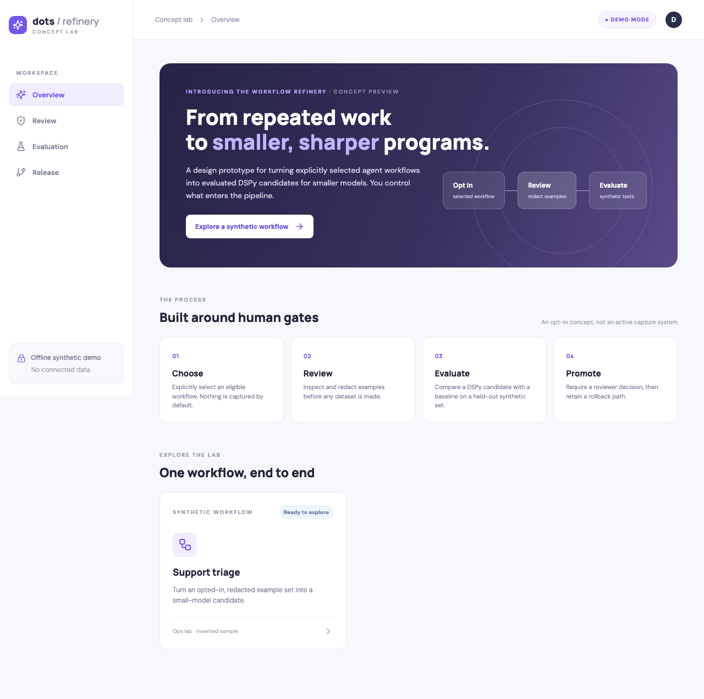
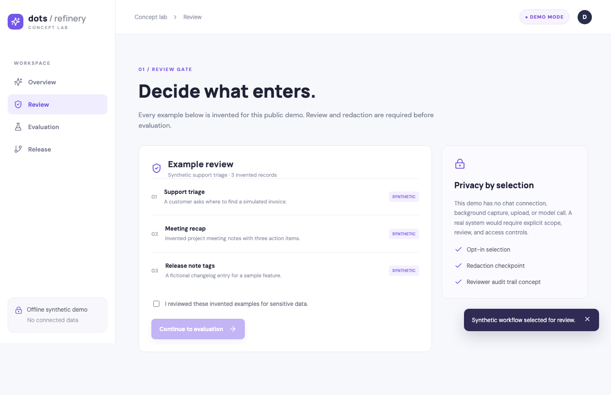
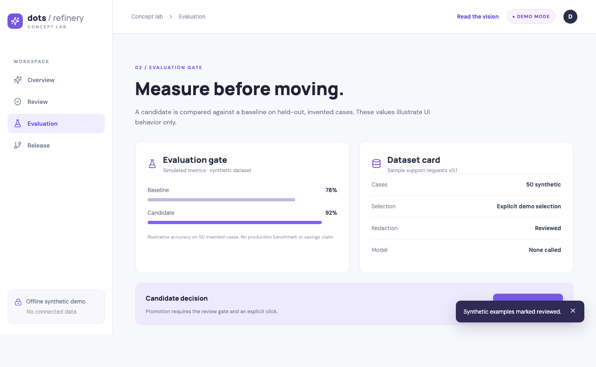
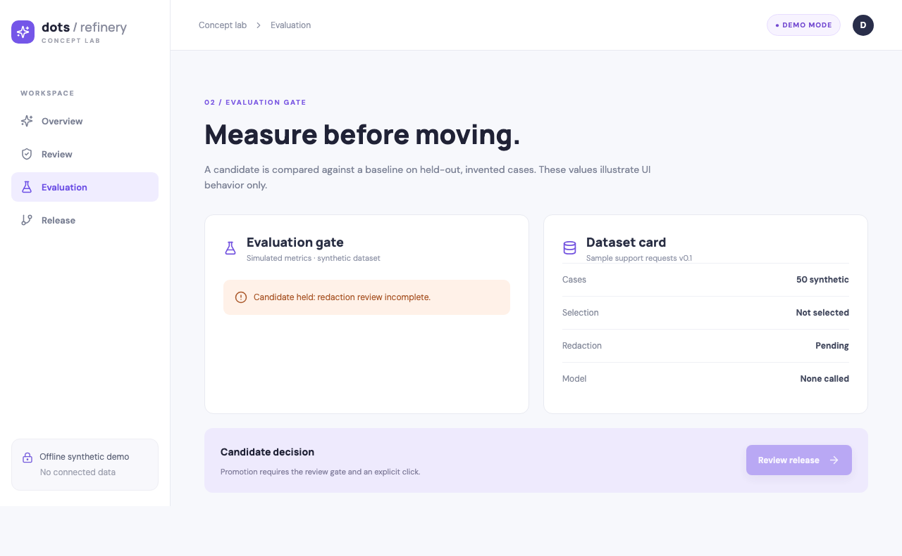

# Dots Workflow Refinery · synthetic concept demo

A public, original React and Storybook prototype for a possible **opt-in workflow refinery**: a person explicitly chooses an eligible agent workflow, reviews and redacts examples, evaluates a DSPy program candidate for a smaller model, and decides whether to promote it with a rollback path.

**This is a design prototype.** It does not continuously read chats, connect to Slack, train a model, call a provider, save a dataset, deploy a service, or report production results. Every workflow, sample, person, score, and metric shown here is invented and **simulated**. The 78% and 92% values illustrate an evaluation interface, not measured performance, savings, or ROI.

## See the synthetic UI



| Review gate | Simulated evaluation | Blocked evaluation |
| --- | --- | --- |
|  |  |  |

[Watch the actual synthetic workflow test recording](artifacts/workflow-walkthrough.webm) (WebM, captured by Playwright during selection, review, evaluation, promotion, and rollback).

Screenshots and the recording are captured by Playwright from the actual React app and checked into this repository. On GitHub Actions, each build captures fresh screenshots and the interaction recording as a downloadable workflow artifact. The [static showcase](https://newdarwindev.github.io/dots-workflow-refinery-demo/) and [Storybook](https://newdarwindev.github.io/dots-workflow-refinery-demo/storybook/) were verified after the successful Pages deploy.

## Proposed vision and generated materials

The [public vision page](https://newdarwindev.github.io/dots-workflow-refinery-demo/vision.html) explains the proposed human-guided compute constellation: selected workflows, reviewed golden datasets, DSPy and smaller-model candidates, versioned artifacts, human promotion gates, and rollback. Lower compute cost with equal or better quality is a **testable hypothesis**, not a measured outcome. The universal reduction of work to agent-controlled computers is a broad thesis with material human, legal, and physical limits. No private conversations or external work actions are used.

- [Static website generation](site-generation/README.md): Vite source, vision page, and artifact verification.
- [TeX white paper source](white-paper-generation/workflow-refinery.tex) and [generated PDF](public/resources/workflow-refinery-white-paper.pdf).
- [Beamer presentation source](presentation-generation/workflow-refinery.tex) and [generated PDF](public/resources/workflow-refinery-presentation.pdf).

The paper and deck now include [eight original vector diagrams](figures/README.md): five substantive controls and three visual complements. Source diagrams and their compiled PDFs are versioned in `figures/`; the public figures use synthetic labels and distinguish observed patterns from proposals. The PDFs are generated locally with Tectonic and committed as versioned public artifacts so the existing Pages workflow can publish them without a TeX setup step. Each generator directory has a reproducible command.

## Walkthrough

1. **Choose:** explicitly select one invented workflow. The demo starts with no selected workflow.
2. **Review:** inspect three synthetic records and mark them reviewed. The Continue button stays disabled until the checkbox is checked.
3. **Evaluate:** see a simulated baseline and candidate alongside a synthetic dataset card. Opening Evaluation before review shows a blocking error.
4. **Promote and roll back:** an explicit promotion click changes only in-browser demo state; rollback restores the previous state.

The prototype makes the workflow gates tangible. It intentionally has no DSPy runtime, dataset storage, model endpoint, production integration, or autonomous capture mechanism. A real implementation would need opt-in scope, authorization, redaction, held-out evaluation, reviewer signoff, auditability, and release controls.

## Run locally

Requires Node 22+.

```sh
npm ci
npm run dev
npm run storybook
```

Open Vite's printed URL for the app and `http://localhost:6006` for Storybook. Storybook includes ready, selected, review-needed, evaluation-complete, and evaluation-blocked states.

```sh
npx playwright install chromium
npm test
npm run build
npm run build-storybook
```

Playwright runs with **one browser worker** and tests real interactions: gating, blocked error state, synthetic evaluation, promotion, and rollback. Screenshots and the WebM interaction recording are written to `artifacts/`. The local dev server used for tests exits when Playwright completes.

## Publishing

`.github/workflows/showcase.yml` runs `npm ci`, installs Chromium, tests the UI, builds Vite and Storybook, uploads the screenshots as an Actions artifact, and deploys the static output with the standard GitHub Pages Actions workflow. Repository Pages must be configured to use **GitHub Actions** as the source. The workflow requests only `contents: read`, `pages: write`, and `id-token: write`. There are no secrets, analytics, paid services, or model calls.

## Source and licenses

The UI, copy, and invented scenarios are original for this demo. Dependencies are official npm packages from React, Storybook, Vite, Playwright, and Lucide. Their upstream projects and licenses remain with their respective owners. This repository's original code is under [MIT](LICENSE); package lockfile records exact installed versions. See `node_modules/<package>/LICENSE` after installation for third-party license texts. Google Fonts (DM Sans and Manrope) are requested by the visual demo; the interface falls back to Arial when offline. No upstream product code or private instructions were used.
